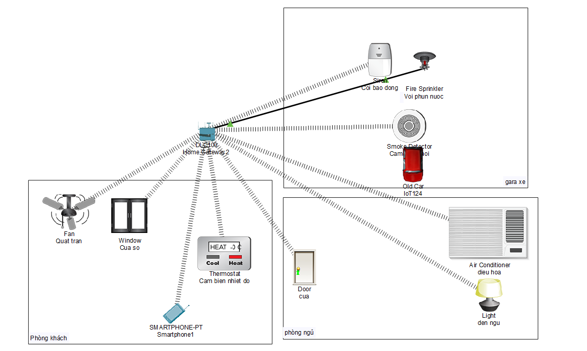

# Mô phỏng Hạ tầng mạng Smart Home (IoT) với Cisco Packet Tracer

## 📌 Tổng quan dự án
Dự án mô phỏng kiến trúc mạng cục bộ (LAN) cho hệ thống Nhà thông minh (Smart Home), tập trung vào việc thiết lập luồng kết nối và quản lý thiết bị IoT.

## ⚙️ Kiến trúc & Hạ tầng mạng
- **Trung tâm điều khiển (Controller):** Sử dụng Home Gateway làm router định tuyến và quản lý dải IP cục bộ cho toàn bộ hệ thống.
- **Phân vùng mạng (Network Zoning):** Phân lập các thiết bị theo 3 khu vực vật lý để dễ quản lý:
  - `Gara xe`: Hệ thống phòng cháy chữa cháy tự động (Cảm biến khói, Còi báo động, Vòi phun nước).
  - `Phòng khách`: Hệ thống điều hòa không khí tự động (Cảm biến nhiệt độ, Quạt trần, Cửa sổ).
  - `Phòng ngủ`: Thiết bị sinh hoạt (Cửa thông minh, Điều hòa, Đèn).
- **Giám sát & Điều khiển:** Thiết lập thiết bị Smartphone đóng vai trò là Client truy cập vào Home Gateway để giám sát trạng thái và điều khiển các thiết bị đầu cuối theo thời gian thực.

## 🚀 Mục tiêu chuyên môn
Hiểu rõ cách thức hoạt động của các giao thức mạng cơ bản, quy hoạch IP, và cách các thiết bị giao tiếp với nhau trong một mạng cục bộ khép kín. Đây là nền tảng cốt lõi để tiếp cận kiến trúc Cloud và DevOps.
